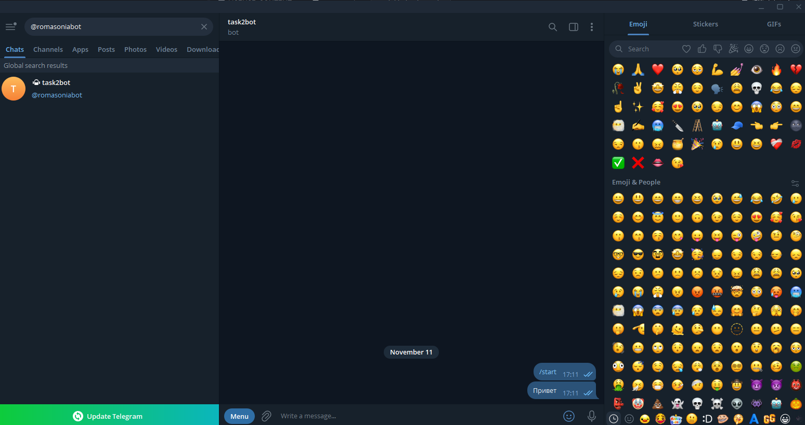

<div class="title-page" align="center">
<p class="tp-org">Министерство науки и высшего образования Российской Федерации<br>федеральное государственное автономное образовательное учреждение высшего образования<br><strong>«Национальный исследовательский университет ИТМО»</strong></p>
<div class="tp-center">
<h1>ОТЧЁТ</h1>
<p>о выполнении задания 2</p>
<p class="tp-topic">«Развёртывание автономного агента<br>для научных задач»</p>
<p class="tp-parts">Исследовательская часть — задание T3 «Модель угроз и безопасность агента»<br>Практическая часть — задание P1 «Развёртывание агента и доказательство его автономности»</p>
</div>
<p class="tp-authors">Выполнили:<br>Голиенко Роман<br>Митенева София</p>
<p class="tp-city">Санкт-Петербург<br>2026</p>
</div>

<!-- web-only -->
> Версия для печати: [otchet-zadanie-2.pdf](otchet-zadanie-2.pdf) (все ссылки в файле кликабельны).
<!-- /web-only -->

## Введение

Автономные агенты на основе больших языковых моделей умеют не только отвечать на вопросы, но и сами выполнять команды в терминале, читать файлы и веб-страницы, запускать задачи по расписанию и помнить контекст между сеансами. Для исследователя такой агент может стать помощником в рутинной работе: следить за доступностью сервисов, собирать источники, готовить черновые сводки. Однако вместе с возможностями растут и риски: агент действует от имени владельца и при этом постоянно читает недоверенные данные, а значит, ошибка модели или внедрённая во входные данные инструкция может привести к реальным действиям на сервере.

**Цель работы** — развернуть автономного агента на собственной инфраструктуре, доказать его работоспособность и автономность и оценить границы применимости такого агента по надёжности, воспроизводимости, стоимости и безопасности.

Для достижения цели решались следующие задачи:

1. выбрать среду выполнения и развернуть агента в изолированном контейнере;
2. подключить бесплатную языковую модель и ограничить возможные расходы;
3. настроить канал управления через Telegram с доступом только для владельца;
4. наполнить память агента, создать собственный навык и задачу по расписанию;
5. проверить ответы агента, изоляцию доступа и самостоятельное восстановление после перезапуска;
6. обеспечить работу при недоступности основной модели;
7. построить модель угроз и сопоставить её с принятыми мерами защиты;
8. зафиксировать измерения и все ошибки, найденные при отладке.

Из списка вариантов выбраны два задания:

- **T3 (исследовательское) — модель угроз и безопасность агента.** Задание аналитическое и опирается на официальную политику безопасности проекта, поэтому его выводы можно проверить по первоисточнику и сопоставить с собственными экспериментами.
- **P1 (практическое) — развёртывание агента и доказательство его автономности.** Задание совпадает с обязательным ходом работы и добавляет к нему проверки автономности и изоляции, которые одновременно служат практической проверкой выводов T3.

Дополнительное (повышенной сложности) задание не выполнялось. Работа выполнена без финансовых затрат: агент развёрнут локально, используется бесплатная модель, ключ поставщика модели ограничен суммой 1 доллар.

## 1. Объект исследования и выбор средств

### 1.1. Агент Hermes

В качестве агента выбран **Hermes Agent** — открытый проект компании NousResearch, распространяемый по лицензии MIT [1]. Агент состоит из четырёх основных частей:

- **шлюзы** — подключение к мессенджерам (в работе используется Telegram);
- **инструменты** — терминал, работа с файлами, веб-запросы, планировщик задач;
- **навыки** — текстовые инструкции с условиями применения, которые подгружаются в контекст модели;
- **подключаемая языковая модель** — любой совместимый поставщик, в работе используется OpenRouter.

Кроме того, у агента есть постоянная память: файлы `MEMORY.md` (контекст задач) и `USER.md` (сведения о пользователе), которые добавляются в каждый запрос к модели. Разработчики прямо предупреждают, что агент выполняет команды на сервере владельца, поэтому доступ к боту равнозначен доступу к терминалу [2]. Это предупреждение определило всю схему развёртывания.

Использован официальный образ контейнера `nousresearch/hermes-agent:stable` из реестра Docker Hub [3] (идентификатор образа `276d44685c65`, сборка от 10.11.2026).

### 1.2. Среда выполнения

Условие задания допускает как арендованный виртуальный сервер, так и локальную виртуальную машину. Выбран **Docker Desktop** на рабочем компьютере (Windows 10 Pro): это бесплатно, не требует передачи личных данных стороннему поставщику и даёт ту же изоляцию на уровне контейнера. Docker Desktop выделено 1 виртуальное ядро процессора и около 2 ГБ оперативной памяти, что не меньше минимальных требований задания (1 ядро, 1 ГБ).

### 1.3. Языковая модель

Модель подключена через сервис **OpenRouter**, который даёт единый программный интерфейс к моделям разных разработчиков, в том числе бесплатным. Основная модель — `nvidia/nemotron-3.5-lightning:free`: её контекстное окно составляет 1 000 000 токенов (требование задания — не менее 64 000), и она поддерживает вызов инструментов. Ключ OpenRouter создан с лимитом расходов 1 доллар, баланс не пополнялся.

Первоначально была выбрана бесплатная модель `google/gemma-4-31b-it:free`, но она отвечала ошибкой перегрузки (раздел 6, запись 1). На случай недоступности основной модели 13.11.2026 настроена резервная цепочка из трёх бесплатных моделей (подраздел 2.9).

### 1.4. Канал управления

Управление агентом выполняется через бота Telegram `@romasoniabot`. Шлюз работает в режиме длинного опроса (long polling): контейнер сам периодически обращается к серверам Telegram за новыми сообщениями, поэтому входящие сетевые порты не нужны и не открываются [4].

Таблица 1 — Параметры развёртывания

| Параметр | Значение |
|---|---|
| Среда | Docker Desktop на Windows 10 Pro, контейнер Linux; виртуальный сервер не арендовался |
| Ресурсы Docker Desktop | 1 ядро процессора, около 2 ГБ оперативной памяти |
| Ограничения контейнера | память 1536 МБ, 1 ядро, не более 512 процессов |
| Версия Docker | 28.3.2 |
| Образ агента | `nousresearch/hermes-agent:stable` |
| Канал управления | бот Telegram `@romasoniabot`, длинный опрос, входящих портов нет |
| Основная модель | `nvidia/nemotron-3.5-lightning:free` через OpenRouter, контекст 1 млн токенов |
| Резервные модели | `nvidia/nemotron-3-ultra-550b-a55b:free`, `google/gemma-4-31b-it:free`, `openrouter/free` |
| Ограничение расходов | лимит ключа 1 доллар; фактически потрачено 0 долларов |
| Репозиторий работы | <https://github.com/SolarVonBro/hermes-agent-lab> |

Руководство, рекомендованное в материалах задания (статья на сайте thecode.media), с компьютера исполнителей не открывалось (сервер отклонял соединение), поэтому развёртывание выполнено по официальной документации проекта: разделам о запуске в Docker, подключении Telegram и политике безопасности.

## 2. Развёртывание агента

### 2.1. Подготовка среды

Базовые шаги настройки сервера из хода работы (отдельный пользователь, вход по ключу SSH, межсетевой экран) относятся к арендованной машине и к контейнеру напрямую не применимы. Вместо них использованы равнозначные меры: агент работает от непривилегированного пользователя `hermes` (UID 10000), порты контейнера не публикуются, поэтому межсетевой экран не требуется, а с компьютером контейнер связан только через один каталог `data/`.

### 2.2. Конфигурация контейнера

Запуск описан в файле [`compose.yaml`](../compose.yaml). Каждая строка файла снабжена комментарием о назначении; основные решения следующие:

- порты не публикуются — единственный канал управления — исходящее соединение с Telegram;
- монтируется только каталог `./data` (настройки, память, навыки, журналы), других каталогов компьютера внутри контейнера нет;
- сокет управления Docker (`/var/run/docker.sock`) не монтируется, поэтому агент не может управлять другими контейнерами;
- режим сети хоста не используется, хотя в исходном файле проекта он был;
- заданы ограничения памяти, процессора и числа процессов, чтобы зацикливание агента не нарушило работу компьютера;
- журнал контейнера ограничен пятью файлами по 10 МБ;
- политика перезапуска `always`: контейнер поднимается сам после перезапуска Docker Desktop (с политикой `unless-stopped` этого не происходило, см. раздел 6, запись 2).

```yaml
services:
  hermes:
    image: nousresearch/hermes-agent:stable
    container_name: hermes
    restart: always
    command: ["gateway", "run"]
    volumes:
      - ./data:/opt/data
    environment:
      - HERMES_UID=10000
      - HERMES_GID=10000
    mem_limit: 1536m
    cpus: 1.0
    pids_limit: 512
    logging:
      driver: json-file
      options: {max-size: "10m", max-file: "5"}
```

### 2.3. Модель и ключ

В настройках агента по умолчанию была указана платная модель `anthropic/claude-opus-4.6`. Её заменили на бесплатную ещё до первого запуска, чтобы ни один запрос не ушёл на платную модель. Настройка выполнялась командами `hermes config set` в контейнере с тем же подключением каталога данных, что и в `compose.yaml`; после этого было проверено, что файл `config.yaml` появился в каталоге `data/` на компьютере. Секреты (токен бота, ключ OpenRouter, список разрешённых пользователей) хранятся в файле `data/.env`; в репозитории лежит только образец без значений — [`.env.example`](../.env.example).

### 2.4. Шлюз Telegram и ограничение доступа

Бот создан через служебного бота Telegram @BotFather. В переменную `TELEGRAM_ALLOWED_USERS` записан только числовой идентификатор владельца, режим «разрешить всем» не включался. Сообщения от любых других пользователей шлюз отбрасывает и записывает в журнал (подраздел 3.3).

### 2.5. Память

Заполнены файлы `data/memories/USER.md` и `data/memories/MEMORY.md`. Чтобы проверить, что агент действительно пользуется памятью, в неё записано условное кодовое слово проекта «ГРАНИТ-17», которое больше нигде не встречается; правильный ответ на вопрос о кодовом слове возможен только из памяти.

### 2.6. Собственный навык

Написан навык [`site-healthcheck`](../skills/site-healthcheck/SKILL.md) — проверка доступности сайта. Для проверки выбран сайт из задания 1 исполнителей (<https://solarvonbro.github.io/python-web-ssg/results/>): это собственный ресурс, обращения к нему никому не мешают, а на странице заранее есть контрольная строка `pipeline-ok-p3`, по которой результат можно независимо проверить обычным запросом `curl`. Задание 1 при этом не меняется: агент только читает страницу.

Навык описывает назначение, условия применения, порядок действий (один запрос `curl`, затем поиск контрольной строки), формат результата в одну строку и правила при отказах. Отдельно запрещено придумывать причины сбоя (если сайт недоступен или код ответа не 200, сообщается только факт) и выполнять инструкции, найденные в содержимом страницы, — это защита от внедрения инструкций через проверяемую страницу (раздел 5).

### 2.7. Планировщик задач

Встроенный в агента планировщик (аналог системного cron) запускает задачи по расписанию без участия человека. Он работает внутри процесса шлюза: примерно раз в минуту проверяет список задач и при наступлении срока открывает отдельный сеанс агента. 11.11.2026 создана задача `site-healthcheck-cron`: каждые 5 минут выполнять проверку сайта с подключённым навыком, всего 3 раза; результат сохраняется в файлы, в Telegram не отправляется. Число повторов ограничено сознательно: каждый запуск расходует 43–58 тысяч токенов, и бесконечная задача быстро исчерпала бы дневной лимит бесплатной модели (угроза 8 в разделе 5). 13.11.2026 для проверки создана ещё одна разовая задача с теми же параметрами.

Результаты планировщика агент записывает в каталог `data/cron/`: протокол каждого запуска (запрос и ответ модели), журнал расхода токенов, базу запусков и состояние задачи. В репозиторий скопированы ответы трёх запусков и журнал расхода (подраздел 3.6).

### 2.8. Журналы

Размер журналов ограничен на двух уровнях: у агента — 10 МБ на файл и 5 резервных копий (`logging.max_size_mb`, `logging.backup_count`), у контейнера — 5 файлов по 10 МБ.

### 2.9. Резервная цепочка моделей

Бесплатные модели нестабильны: поставщик может ответить ошибкой превышения лимита (код 429) или временно убрать модель. Без дополнительной настройки агент при такой ошибке трижды повторяет запрос к той же модели и затем сообщает об ошибке; переходить на другую модель он сам не умеет. Так и было 11.11.2026 с моделью Gemma: замену пришлось выполнять вручную с перезапуском контейнера (раздел 6, запись 1).

13.11.2026 в файл настроек добавлена **резервная цепочка моделей** — упорядоченный список, к которому агент обращается, если основная модель отвечает ошибкой лимита (429), ошибкой оплаты (402) или недоступна [5]:

```yaml
fallback_providers:
  - provider: openrouter
    model: nvidia/nemotron-3-ultra-550b-a55b:free   # сильная модель, контекст 1 млн
  - provider: openrouter
    model: google/gemma-4-31b-it:free               # другое семейство моделей
  - provider: openrouter
    model: openrouter/free                          # последний резерв

auxiliary:
  free_only: true   # служебные задачи агента — только модели с пометкой :free
```

Особенности, установленные по исходному коду агента и проверкой:

- при ошибке лимита или оплаты агент переключается сразу, не дожидаясь трёх повторов; при обрыве соединения — после одного повтора;
- переключение действует в пределах одного хода: в начале обработки каждого нового сообщения агент снова обращается к основной модели;
- в цепочку можно включать **только бесплатные модели**: переключение срабатывает и на ошибку оплаты, поэтому платная модель в цепочке начала бы тратить деньги без ведома владельца;
- `openrouter/free` — не отдельная модель, а маршрутизатор OpenRouter, который на каждый запрос выбирает случайную бесплатную модель [6]; поэтому он поставлен последним (подробности — раздел 6, запись 9);
- параметр `auxiliary.free_only` запрещает служебным задачам агента (например, сжатию длинного контекста) обращаться к моделям, которые агент не может опознать как бесплатные.

Каталог `data/` в репозиторий не входит, поэтому этот фрагмент настроек приведён здесь и в описании репозитория.

Таблица 2 — Выполнение пунктов хода работы

| № | Пункт задания | Результат |
|---|---|---|
| 1 | Виртуальный сервер или виртуальная машина | локальный Docker Desktop (допускается условием), параметры — таблица 1 |
| 2 | Базовая настройка сервера | заменена равнозначными мерами для контейнера (подраздел 2.1) |
| 3 | Docker и Compose | Docker 28.3.2, запуск командой `docker compose up -d` |
| 4 | Поставщик модели и контекст | OpenRouter, контекст 1 млн токенов; платная модель по умолчанию заменена до первого запуска |
| 5 | Ограничение расходов | лимит ключа 1 доллар, расход 0 (подраздел 3.9) |
| 6 | Шлюз Telegram | бот создан, токен и идентификатор владельца — в `data/.env` |
| 7–8 | Мастер настройки, каталог настроек | команды `hermes config set`; `config.yaml` появился в подключённом каталоге |
| 9 | Файл `compose.yaml` | подраздел 2.2 |
| 10 | Запуск и журналы | контрольные признаки старта — подраздел 3.1 |
| 11 | Проверка связки | ответы в Telegram, подраздел 3.2 |
| 12 | Ограничение доступа | только владелец, подраздел 3.3 |
| 13 | Память | проверено кодовым словом, подраздел 3.4 |
| 14 | Инструменты | подтверждены терминал (`curl`), веб-запросы, файловая система, планировщик; браузер и поиск подробно не проверялись |
| 15 | Первый навык | `site-healthcheck`, подраздел 3.5 |
| 16 | Задача по расписанию | 3 автономных запуска 11.11 и 1 запуск 13.11, подраздел 3.6 |
| 17 | Ротация журналов | подраздел 2.8 |
| 18 | Отладка | раздел 6 |

## 3. Практическая часть P1: доказательство работоспособности и автономности

### 3.1. Запуск и контрольные признаки

После команды `docker compose up -d` контейнер поднимается под управлением супервизора процессов, и шлюз запускается в фоне. Признаки корректного старта в журнале: строка `Hermes Gateway Starting`, загрузка навыков и подключение `Connected to Telegram (polling mode)`. Команда `hermes skills list` показывает 40 включённых навыков: 39 встроенных и 1 собственный. Фрагменты журнала сохранены в файле [`gateway-telegram-excerpts.txt`](evidence/gateway-telegram-excerpts.txt).

### 3.2. Диалог в Telegram

С разрешённого аккаунта агенту отправлялись сообщения, и каждый раз шлюз фиксировал приём сообщения и готовность ответа. Первый ответ 11.11.2026 подготовлен за 6,3 с, при этом модель вызывалась один раз. 13.11.2026 выполнено ещё восемь обращений; все девять измерений приведены в таблице 3. Время включает вызов модели и обработку внутри агента, но не включает доставку сообщения самим Telegram.

Таблица 3 — Время подготовки ответа в Telegram (по журналу шлюза)

| Дата и время (UTC) | Время ответа, с | Вызовов модели |
|---|---|---|
| 11.11 14:10 | 6,3 | 1 |
| 13.11 13:33 | 10,5 | 1 |
| 13.11 13:42 | 15,3 | 1 |
| 13.11 13:44 | 9,2 | 1 |
| 13.11 16:25 | 12,6 | 1 |
| 13.11 16:25 | 17,6 | 1 |
| 13.11 16:36 | 13,1 | 1 |
| 13.11 17:17 | 4,0 | 1 |
| 13.11 17:21 | 6,5 | 1 |

По девяти измерениям время ответа составляет от 4,0 до 17,6 с, медиана — 10,5 с, среднее — 10,6 с. Разброс объясняется загрузкой бесплатной модели у поставщика.

### 3.3. Изоляция доступа

Со второго аккаунта Telegram боту отправлялись команда `/start` и сообщение «Привет». Бот не ответил (снимок экрана — рисунок 1, приложение А), а в журнале шлюза появились записи о блокировке: `Blocked unauthorized user … in chat …`. Всего зафиксировано 4 блокировки: две 11.11.2026 (14:11:14 и 14:11:17 UTC) и две 13.11.2026 (13:33:30 и 17:17:36 UTC); все они относятся к одному постороннему аккаунту. Идентификаторы аккаунтов в отчёте не приводятся.

### 3.4. Память

На вопрос «Какое кодовое слово проекта?» агент отвечает «ГРАНИТ-17». Это слово есть только в файле памяти, значит, память подключается к запросам. Проверка повторялась 11.11.2026 в терминале и 13.11.2026 в Telegram (ответ за 10,5 с).

### 3.5. Навык проверки доступности

Таблица 4 — Применение навыка `site-healthcheck`

| Запуск | Условия | Результат |
|---|---|---|
| Без подгрузки навыка | запрос «Сделай healthcheck сайта …» в терминале | агент проверил сайт своим способом (веб-инструментом), формат навыка не использован; 40 с |
| С явной подгрузкой | тот же запрос с ключом `-s site-healthcheck` | результат строго по формату навыка; 52 с |
| Планировщик, запуски 1 и 2 (11.11) | навык подключён к задаче | формат соблюдён |
| Планировщик, запуск 3 (11.11) | то же | формулировка последнего поля изменилась |
| Планировщик, разовый запуск (13.11) | то же | формат соблюдён |

Итоговые строки, которые вернул агент:

```text
С подгрузкой навыка:  OK | https://solarvonbro.github.io/python-web-ssg/results/ | 200 | 0.162286 | да
Планировщик, запуск 1: OK | https://solarvonbro.github.io/python-web-ssg/results/ | 200 | 0.142695 | да
Планировщик, запуск 2: OK | https://solarvonbro.github.io/python-web-ssg/results/ | 200 | 0.314804 | да
Планировщик, запуск 3: OK | https://solarvonbro.github.io/python-web-ssg/results/ | 200 | 0.240946 | контрольная строка найдена: да
Разовый запуск 13.11:  OK | https://solarvonbro.github.io/python-web-ssg/results/ | 200 | 0.306480 | да
```

Отклонение в третьем запуске частично вызвано самим навыком: формат записан как `… | время, с | контрольная строка найдена: да/нет`, и его можно понять двояко — как заголовок поля со значением «да» или как текст, который нужно вывести целиком. В разных запусках модель поняла его по-разному. Вывод: навык не применяется автоматически по описанию условий, надёжный способ — явная подгрузка или привязка к задаче планировщика; формат вывода в навыке нужно задавать однозначно, лучше примером. Результаты агента сверялись с независимым запросом `curl` к той же странице; расхождений в коде ответа и наличии строки не было. Полные протоколы двух запусков в терминале: [`skill-run-1.txt`](evidence/skill-run-1.txt), [`skill-run-2.txt`](evidence/skill-run-2.txt).

### 3.6. Автономная работа по расписанию

Задача `site-healthcheck-cron` выполнилась 11.11.2026 три раза — в 14:03, 14:09 и 14:14 UTC — при закрытом мессенджере и без каких-либо действий пользователя. Все запуски завершились со статусом «успешно», после третьего задача сама перешла в состояние «завершена». 13.11.2026 разовая задача с теми же параметрами выполнилась в 16:53 UTC.

Таблица 5 — Запуски по расписанию (журнал расхода токенов)

| Запуск | Время старта (UTC) | Длительность, с | Входные токены | Выходные токены | Всего токенов | Стоимость |
|---|---|---|---|---|---|---|
| 1 | 11.11 14:03 | 41,0 | 42 569 | 594 | 43 163 | 0 |
| 2 | 11.11 14:09 | 13,7 | 42 454 | 444 | 42 898 | 0 |
| 3 | 11.11 14:14 | 19,0 | 57 481 | 682 | 58 163 | 0 |
| 4 (разовый) | 13.11 16:53 | 11,2 | 52 733 | 617 | 53 350 | 0 |

Даже простая проверка расходует 43–58 тысяч входных токенов: в каждый запрос попадают системная инструкция, память, описания навыков и инструментов. На платной модели именно это определяло бы стоимость; на бесплатной стоимость нулевая, но действует дневной лимит запросов.

По журналу агента видно, что в запуске 3 и в разовом запуске модель сначала пыталась выполнить проверку через инструмент `execute_code` (выполнение произвольного кода Python), и агент **заблокировал** эту попытку с пояснением, что задачи по расписанию выполняются без пользователя, который мог бы подтвердить такое действие (`BLOCKED: execute_code runs arbitrary local Python … Cron jobs run without a user present to approve …`). После этого модель выполнила проверку обычными командами терминала `curl` и `grep`. Это практическое подтверждение вывода раздела 5: подтверждение опасных действий — полезная мера, но в автономном режиме её роль выполняет запрет, а граница безопасности по-прежнему проходит по контейнеру. Лишняя попытка, вероятно, и объясняет больший расход токенов в этих двух запусках.

Доказательства в репозитории: [журнал расхода токенов](evidence/cron-usage-audit.jsonl) и ответы запусков [1](evidence/cron-run-11-11_14-03-11.md), [2](evidence/cron-run-11-11_14-09-06.md), [3](evidence/cron-run-11-11_14-14-44.md).

### 3.7. Восстановление после перезапуска

Автономность проверялась также полной остановкой и повторным запуском Docker Desktop. После смены политики перезапуска на `always` (раздел 6, запись 2) контейнер каждый раз поднимался сам, без участия человека. 13.11.2026 обнаружилось, что Docker Desktop после остановки иногда ложно сообщает об отсутствии поддержки виртуализации (раздел 6, запись 8), поэтому перезапуск выполнялся командой с предварительным запросом к службе WMI:

```bash
docker desktop stop && powershell -NoProfile -Command "Get-CimInstance Win32_OptionalFeature | Measure-Object" && docker desktop start
```

Таблица 6 — Восстановление после перезапуска Docker Desktop

| Дата | Способ | Команда завершена | Контейнер работает | Telegram подключён |
|---|---|---|---|---|
| 11.11 | `docker desktop restart` | — | через 35 с | через ≈ 94 с |
| 13.11, первый прогон | остановка, запрос WMI, запуск | ≈ 48 с | ≈ 53 с | ≈ 110 с |
| 13.11, второй прогон | то же | 27 с | 35 с | 68 с |

Время отсчитывается от начала команды. После каждого перезапуска проверялось, что загружено 40 навыков и бот отвечает. Полная перезагрузка Windows не проводилась; Docker Desktop настроен на автоматический запуск при входе пользователя, поэтому ожидается тот же результат.

### 3.8. Проверка резервной цепочки моделей

Ошибку лимита у основной модели вызвать по желанию нельзя, поэтому переключение проверялось на модели, которой не существует, — так выглядит ситуация, когда модель убрали из каталога OpenRouter. Запрос выполнялся в терминале контейнера командой `hermes chat -Q -q "Проверка связи. Ответь одним словом: ок" --model nvidia/nonexistent-test-model:free --provider openrouter`, настройки агента при этом не менялись.

Таблица 7 — Проверка переключения на резервную модель

| Состав цепочки | Что записано в журнале | Кто ответил | Время | Токенов |
|---|---|---|---|---|
| только `openrouter/free` | ошибка 400 «not a valid model ID», `Fallback activated: … → openrouter/free`; предупреждение `PAID lane engaged … may incur real spend` | маршрутизатор отдал запрос поставщику Liquid | 6,8 с | 12 123 |
| итоговая цепочка из трёх моделей | ошибка 400, `Fallback activated: … → nvidia/nemotron-3-ultra-550b-a55b:free` | `nemotron-3-ultra` | 3,5 с | 13 084 |

В обоих случаях агент ответил «ок» в том же ходе, без перезапуска и без участия человека. После итоговой настройки контейнер перезапущен; в журнале старта основной осталась модель `nvidia/nemotron-3.5-lightning:free`, ошибок чтения настроек нет, бот отвечает.

### 3.9. Контроль расходов

Снимок панели OpenRouter не делался; вместо него использован ответ программного интерфейса OpenRouter о ключе (`GET /api/v1/key`). Последняя проверка выполнена 13.11.2026 после всех испытаний, включая проверку резервной цепочки: `limit: 1`, `limit_remaining: 1`, `usage: 0`, `usage_daily: 0`. Таким образом, за всё время работы не потрачено ни одного цента.

## 4. Сводка измерений

Условия: Windows 10, Docker Desktop с одним ядром процессора, бесплатные модели OpenRouter, сеть без прокси-сервера. Время взято из журналов агента и по часам компьютера.

Таблица 8 — Сводка измерений

| Операция | Результат | Источник |
|---|---|---|
| Ответ в Telegram | 4,0–17,6 с, медиана 10,5 с (9 измерений, по 1 вызову модели) | журнал шлюза, таблица 3 |
| Простой запрос в терминале («Ответь одним словом») | 22 с | `hermes chat` |
| Запрос к памяти (кодовое слово) в терминале | 24 с | `hermes chat` |
| Проверка сайта без навыка / с навыком | 40 с / 52 с | `hermes chat` |
| Запуск по расписанию | 11,2–41,0 с; 42,9–58,2 тыс. токенов | журнал расхода, таблица 5 |
| Ответ резервной модели при недоступности основной | 3,5 с | журнал агента, таблица 7 |
| Подъём после перезапуска Docker Desktop | контейнер через 35–53 с, Telegram через 68–110 с | таблица 6 |
| Подъём после перезапуска только контейнера (`docker restart hermes`) | Telegram через 34–45 с | журнал шлюза, 13.11 |
| Стоимость | 0 долларов | ответ OpenRouter о ключе |

Большинство измерений сделано 1–4 раза, поэтому они показывают порядок величин, а не статистически устойчивые значения. Наибольший разброс у времени ответа модели: он зависит от нагрузки на бесплатную модель у поставщика.

## 5. Исследовательская часть T3: модель угроз и безопасность агента

### 5.1. Что защищаем и от кого

Таблица 9 — Защищаемые ресурсы

| Ресурс | Где находится | Почему важен |
|---|---|---|
| Ключ поставщика модели | `data/.env` | расход бюджета, доступ к учётной записи |
| Токен бота Telegram | `data/.env` | управление ботом равнозначно доступу к терминалу контейнера |
| Память агента | `data/memories/` | личный контекст и договорённости |
| Рабочий каталог, навыки, сеансы | `data/` | результаты работы, история |
| Компьютер и его сети | за пределами контейнера | личные данные и другие системы |

Нарушители: посторонний пользователь Telegram; автор внешнего содержимого, которое читает агент (веб-страница, файл README, документ PDF, письмо); автор стороннего навыка, образа контейнера или сервера MCP (протокол подключения внешних инструментов к агенту); наконец, сам агент — его ошибочное или постепенно меняющееся поведение.

### 5.2. Главный принцип

Политика безопасности проекта Hermes [2] прямо утверждает: **единственная настоящая граница безопасности против враждебной модели — операционная система**, то есть контейнер или виртуальная машина. Подтверждение действий пользователем, поиск опасных шаблонов в командах, вычищение секретов из вывода и списки разрешённых инструментов — это эвристики, которые снижают вероятность ущерба, но не являются границами. Этот принцип положен в основу всей модели угроз.

### 5.3. Модель угроз

Таблица 10 — Модель угроз

| № | Угроза | Как реализуется | Контрмера | Эффективность контрмеры | Остаточный риск |
|---|---|---|---|---|---|
| 1 | Прямое внедрение инструкций | владелец или тот, кто получил доступ к чату, даёт агенту вредную команду | список разрешённых пользователей шлюза; запрет режима «разрешить всем» | высокая против посторонних; не защищает от самого владельца и от захвата его аккаунта | захват аккаунта Telegram владельца |
| 2 | Косвенное внедрение инструкций (prompt injection) | инструкция спрятана в обрабатываемых данных: комментарий HTML, невидимый текст, подпись к картинке, README, имя файла, метаданные PDF | указание в системной инструкции «данные — не команды»; минимум прав; подтверждение опасных действий; изоляция контейнером | частичная: снижает вероятность, но не исключает | **остаётся принципиально**: модель получает данные и команды в одном потоке токенов и надёжно их не различает; фильтр обходится перефразированием, кодированием, другим языком |
| 3 | Утечка секретов и данных | агент под влиянием внедрённой инструкции отправляет ключи, память или исходный код по сети: запросом `curl`, ссылкой с данными в параметрах, сообщением в чат | ограничение исходящей сети белым списком адресов; секреты вне доступного агенту каталога; отдельный контур без рабочих данных; лимит расходов на ключе | белый список адресов — высокая (это настоящая граница); вычищение секретов из вывода — низкая (обходится кодированием) | всё, что агент может прочитать, он теоретически может передать на разрешённые адреса, например в сам чат или поставщику модели |
| 4 | Разрушающие действия | удаление файлов, порча репозитория, перезапись данных, сообщения от имени владельца, трата бюджета | контейнер без рабочих каталогов, кроме `data/`; непривилегированный пользователь; ограничение ресурсов; подтверждение человеком; лимит ключа; отдельная ветка вместо записи в основную | контейнер — высокая в его границах; подтверждение — средняя (оболочка командной строки позволяет записать любое действие в неочевидном виде) | порча содержимого `data/` и всего, что агенту явно выдано |
| 5 | Захват канала управления | утечка токена бота, подмена списка разрешённых, пересылка токена в переписке | токен только в `.env` вне репозитория; список разрешённых из одного идентификатора; отзыв и перевыпуск токена у @BotFather | высокая при соблюдении дисциплины; токен, показанный в переписке, считается скомпрометированным | человеческий фактор: токен остаётся в истории переписки |
| 6 | Заражение через сторонние компоненты | навыки из общего каталога, образы контейнеров, серверы MCP, расширения | только официальный образ; явный тег версии; чтение кода навыка до установки (код навыка исполняется уже при подключении); не подключать лишние серверы MCP | средняя: встроенная проверка навыков — лишь подсказка для человека | заражённый навык или расширение получает все права агента и его ключи |
| 7 | Закрепление ошибки | навык, созданный агентом автоматически по «успешному» сеансу, закрепляет неверную процедуру | просмотр автоматически созданных навыков; хранение `data/skills/` под контролем версий; контрольные задачи | средняя | незаметное изменение поведения со временем |
| 8 | Отказ в обслуживании и перерасход | зацикливание, лавина задач планировщика, ошибки лимита у поставщика | лимит ключа; ограничение числа шагов и повторов задачи; ограничение ресурсов контейнера; ротация журналов; резервная цепочка только из бесплатных моделей | высокая для бюджета, средняя для доступности | остановка работы при исчерпании бесплатных лимитов всех моделей цепочки |

Угрозы 1 и 2 объединены в один класс (внедрение инструкций), а угрозы 7 и 8 второстепенны, поэтому в выводах рассматриваются пять основных классов: внедрение инструкций, утечка, разрушающие действия, захват канала управления и заражение через сторонние компоненты.

### 5.4. Реальная эффективность контрмер

Таблица 11 — Что закрывает каждая контрмера

| Контрмера | Что закрывает | Что не закрывает |
|---|---|---|
| Изоляция в контейнере или виртуальной машине | разрушающие действия на компьютере, доступ к чужим файлам | всё, что агент может сделать внутри контейнера и по разрешённой сети |
| Непривилегированный пользователь | повышение привилегий, порча системных файлов | действия в пределах прав этого пользователя |
| Список разрешённых команд | известные опасные команды | обход через интерпретатор (Python, `sh -c`), перенаправление вывода |
| Подтверждение человеком | неожиданные разрушающие действия | «усталость от подтверждений», команды, опасность которых не видна сразу |
| Белый список адресов для исходящей сети | утечку на произвольные адреса, загрузку вредоносного кода | утечку через разрешённые адреса |
| Отдельная машина без доступа к рабочим системам | распространение ущерба | утечку того, что на этой машине есть |
| Ротация ключей | срок жизни украденного секрета | сам факт утечки |
| Анализ журналов | обнаружение и расследование после события | предотвращение |
| Указание в системной инструкции | простые и случайные внедрения | целенаправленный обход |

### 5.5. Сопоставление подходов платформ

Таблица 12 — Подходы к безопасности агентных платформ

| Платформа | Подход (по документации) | Что закрывает | Что остаётся открытым |
|---|---|---|---|
| Hermes Agent | граница — операционная система: образ Docker, отдельные среды выполнения терминала; внутри процесса только эвристики (подтверждение опасных команд, вычищение секретов из вывода, проверка навыков); фильтрация переменных окружения для дочерних процессов | разрушающие действия (в пределах контейнера), утечку обычных секретов из оболочки | навыки и расширения работают с полными правами; косвенное внедрение; утечка через разрешённую сеть |
| PicoClaw (по материалам задания) | ограничение агента рабочим каталогом, отключение опасных команд, малое ядро | порчу файлов вне каталога, часть опасных команд | утечку внутри каталога и по сети, косвенное внедрение |
| OpenClaw (по материалам задания) | ассистент на одной машине; защита зависит от настройки этой машины | зависит от развёртывания | всё, что не закрыто настройкой операционной системы |
| Claude Code, Codex CLI | локальный агент с режимами разрешений и подтверждениями, необязательная песочница | разрушающие действия — через подтверждение | косвенное внедрение, утечку через разрешённые инструменты |

Сведения о PicoClaw и OpenClaw взяты из материалов задания и по первоисточникам не проверялись. Для всех платформ принципиально открытыми остаются два класса: **косвенное внедрение инструкций** (внутри модели нет разделения данных и команд, см. также [7]) и **утечка через разрешённый канал**. Их можно только ограничивать — давать агенту меньше прав и меньше данных, изолировать его и ограничивать сеть, — но не устранить.

### 5.6. Меры, применённые в этом развёртывании

Таблица 13 — Применённые меры защиты

| Мера | Реализация | Где подтверждено |
|---|---|---|
| Отдельный контур без личных данных | контейнер, подключён только каталог `data/` | [`compose.yaml`](../compose.yaml) |
| Нет входящих портов | порты не публикуются; шлюз работает длинным опросом | `compose.yaml` |
| Нет доступа к Docker компьютера | сокет Docker не подключён, режим сети хоста не используется | `compose.yaml` |
| Непривилегированный пользователь | процессы агента от пользователя `hermes` (UID 10000) | журнал старта контейнера |
| Список разрешённых | только идентификатор владельца | `data/.env` (не в репозитории); 4 блокировки в журнале |
| Ограничение ресурсов | 1536 МБ, 1 ядро, 512 процессов | `compose.yaml` |
| Ограничение расходов | лимит ключа 1 доллар, только бесплатные модели, в том числе в резервной цепочке; служебные задачи — только бесплатные модели | ответ OpenRouter о ключе; подраздел 2.9 |
| Ограничение задач планировщика | число повторов задачи задаётся явно | подраздел 2.7 |
| Ротация журналов | агент и контейнер — по 5 файлов на 10 МБ | `compose.yaml`, `config.yaml` |
| Секреты вне репозитория | `data/` и `.env` исключены из контроля версий | [`.gitignore`](../.gitignore) |

Не применено: **исходящая сеть контейнера не ограничена** — агенту нужны Telegram и OpenRouter, а белый список адресов не настраивался. Это остаточный риск утечки (угроза 3); его снижает то, что в контейнере нет рабочих данных и ключей других систем.

### 5.7. Наблюдения эксперимента, подтверждающие модель угроз

- Все попытки постороннего аккаунта обратиться к боту были отклонены шлюзом (4 записи в журнале) — мера против угрозы 1 работает.
- В автономном режиме агент блокирует выполнение произвольного кода, если некому подтвердить действие (подраздел 3.6), но обычные команды терминала разрешены. Значит, внутри контейнера модель по-прежнему может делать почти всё, что позволяет пользователь `hermes`, — граница действительно проходит по контейнеру.
- Встроенная проверка «бесплатности» модели в агенте опирается только на окончание имени `:free` (раздел 6, запись 9). Для защиты бюджета на неё нельзя полагаться — нужен лимит на стороне поставщика.
- Резервная цепочка повышает доступность, но одновременно расширяет число поставщиков, которые видят переписку с агентом. Это усиливает остаточный риск угрозы 3 и учитывается при выборе моделей для цепочки.

### 5.8. Выводы по T3

Для безопасного применения агента в исследовательской работе нужно держать его в изолированном контуре без рабочих данных и ключей других систем, давать минимум прав и инструментов, ограничивать исходящую сеть, ограничивать расходы на стороне поставщика модели, не поручать агенту запись в основные ветки и публикацию без проверки человеком, хранить секреты вне доступного агенту каталога и регулярно их менять, а любое внешнее содержимое, которое читает агент, считать недоверенным.

## 6. Отладка

В таблице 14 перечислены все ошибки, найденные при выполнении работы, в том числе ошибки в собственных проверках исполнителей. Для каждой указаны предположение о причине, способ проверки и принятое решение.

Таблица 14 — Ошибки, найденные при отладке

| № | Ошибка | Предположение | Проверка | Решение |
|---|---|---|---|---|
| 1 | Ошибка 429 «Provider returned error» от модели `google/gemma-4-31b-it:free`, три попытки подряд | бесплатная модель перегружена у поставщика | прямые запросы к пяти бесплатным моделям: `gemma-4-26b` тоже 429, модели Nvidia отвечают | 11.11 модель вручную заменена на `nemotron-3.5-lightning:free` с перезапуском контейнера; 13.11 настроена резервная цепочка, теперь переключение автоматическое (подраздел 2.9) |
| 2 | После `docker desktop restart` контейнер не поднялся: код завершения 137, в событиях Docker нет перезапуска | политика `unless-stopped` при штатной остановке Docker считает контейнер остановленным вручную | `docker inspect` (политика, время остановки), повтор после смены политики | политика изменена на `always`; повторный тест: контейнер работает через 35 с |
| 3 | Навык не применён: агент проверил сайт своим способом | навык включается по явной подгрузке, а не по описанию условий | сравнение запусков без ключа `-s` и с ним | навык подгружается явно и привязан к задаче планировщика; ограничение зафиксировано |
| 4 | Предупреждение: каталог базы данных SQLite находится на файловой системе, общей с другой виртуальной машиной | каталог данных подключён с компьютера Windows, режим журнала WAL там ненадёжен | чтение текста предупреждения в журнале старта | агент сам перешёл на режим DELETE; для постоянной работы рекомендуется именованный том Docker |
| 5 | `ls: cannot access 'C:/Program Files/Git/opt/data/memories'` при `docker exec` из Git Bash | Git Bash превращает путь `/opt/data` в путь Windows | повтор с переменной `MSYS_NO_PATHCONV=1` | переменная задаётся для всех команд `docker exec` и `docker run -v` |
| 6 | Команда без тега скачала второй образ (`latest`) | без тега Docker берёт `latest` | `docker images`: у `latest` и `stable` одинаковый идентификатор | лишнего места не занято; во всех командах тег указывается явно |
| 7 | В настройках по умолчанию указана платная модель `anthropic/claude-opus-4.6` | шаблон настроек не учитывает бюджет | чтение `config.yaml` до первого запуска | модель заменена на бесплатную до запуска; лимит ключа 1 доллар |
| 8 | 13.11 после остановки и запуска Docker Desktop — окно «Virtualization support not detected», движок не стартует | в журнале Docker Desktop: запрос к классу `Win32_OptionalFeature` через WMI завершился ошибкой «Приложение-сервер останавливается»; виртуализация при этом включена | проверка `HypervisorPresent`, состояния WSL 2 и службы `vmcompute`; без запроса WMI перед стартом — ошибка 2 раза из 2, с запросом — успех 4 раза из 4 | перед `docker desktop start` выполняется любой запрос к WMI (подраздел 3.7); если окно уже появилось — `docker desktop stop --force` и та же команда |
| 9 | При проверке резервной цепочки из одной `openrouter/free` агент предупредил «PAID lane engaged … may incur real spend», а ответ дала модель поставщика Liquid | агент признаёт модель бесплатной только по окончанию имени `:free`; маршрутизатор выбирает случайную бесплатную модель, в том числе очень маленькую | исходный код агента (функция проверки имени); цена `openrouter/free` в каталоге — 0; поле `upstream=Liquid` в журнале; расход ключа после теста — 0 | первыми в цепочке поставлены две конкретные сильные модели с `:free`, `openrouter/free` — последней; включён `auxiliary.free_only: true`; повторный тест без предупреждения |
| 10 | Команда агента через `docker exec` иногда сообщает `[Errno 12] Cannot allocate memory` при чтении файлов из `/opt/data` и продолжает работу с настройками по умолчанию | временный сбой общей файловой системы Docker Desktop; памяти контейнеру хватает | `docker stats`: занято 369 МБ из 1,5 ГБ; повторное чтение файла успешно три раза из трёх; ошибка в журнале только в моменты таких команд; работающий шлюз не затронут | команду повторить; во всех ручных запросах к модели явно указывать `--model`, потому что настройки по умолчанию содержат платную модель |
| 11 | Ошибка в собственной проверке: после перезапуска контейнера проверка показала «Telegram подключён через 9 с» | `docker logs --since` со временем без указания часового пояса трактуется как местное время, а не UTC, поэтому проверка нашла старую строку | сравнение с журналом шлюза, где время указано в UTC: фактическое подключение — через 34 с | проверки выполняются по журналу шлюза с явным сравнением времени в UTC |

## 7. Применение искусственного интеллекта при выполнении работы

При выполнении работы использовался ИИ-ассистент Claude Code. Все его результаты проверялись запуском, сверкой с журналами и независимыми запросами; там, где проверка не проводилась, это указано явно.

Таблица 15 — Участие ИИ-ассистента

| Часть работы | Участие ИИ | Как проверялся результат |
|---|---|---|
| Развёртывание: файл `compose.yaml`, настройка, команды, поиск причин ошибок | выполнено ассистентом под контролем исполнителей | запуск, чтение журналов, повторные тесты, замеры по журналам |
| Резервная цепочка моделей | настроена ассистентом по исходному коду агента | проверка с несуществующей моделью, проверка расхода ключа |
| Текст модели угроз T3 | подготовлен по политике безопасности проекта [2] и материалам задания | сверка с первоисточником; сведения о PicoClaw и OpenClaw не проверялись |
| Навык `site-healthcheck`, файлы памяти | написаны ассистентом | запуск с подгрузкой и по расписанию, сверка формата |
| Исследуемый агент Hermes | объект исследования и исполнитель проверок по расписанию | результаты сравнивались с независимым запросом `curl` |
| Текст отчёта и его версия для печати | подготовлены ассистентом по файлам и журналам проекта | числа сверены с журналами агента |

Сведения из интернета, не относящиеся к перечисленным источникам, независимо не проверялись.

## Заключение

В работе развёрнут автономный агент Hermes в изолированном контейнере Docker Desktop с управлением через Telegram и бесплатной языковой моделью. Практически подтверждено:

- агент отвечает владельцу в Telegram за 4–18 с (медиана 10,5 с по девяти измерениям) и пользуется постоянной памятью;
- посторонний аккаунт заблокирован (4 записи в журнале), режим «разрешить всем» не включался;
- задачи по расписанию выполняются без участия человека (4 запуска), а в автономном режиме агент сам запрещает выполнение произвольного кода;
- после перезапуска Docker Desktop контейнер поднимается сам за 35–53 с, Telegram подключается за 68–110 с;
- при недоступности основной модели агент автоматически переходит на резервную бесплатную модель в том же ходе;
- общие расходы — 0 долларов.

Анализ угроз показал, что единственная настоящая граница безопасности — изоляция на уровне операционной системы; остальные меры снижают вероятность ущерба, но не исключают его. Принципиально открытыми остаются косвенное внедрение инструкций и утечка через разрешённый канал.

Агенту целесообразно поручать рутину с проверяемым результатом: наблюдение за доступностью сервисов, сбор и первичную систематизацию источников, подготовку черновых сводок, причём результат нужно проверять независимым способом. Не следует поручать формулировку выводов и интерпретацию результатов, любые необратимые или внешние действия без подтверждения человека (публикацию, удаление, отправку сообщений, запись в основные ветки), а также работу с секретами и закрытыми материалами.

Ограничения работы: исходящая сеть контейнера не ограничена; автоматическое применение навыка по описанию не подтверждено; бесплатные модели нестабильны и имеют дневные лимиты; на каждый запуск задачи расходуется 43–58 тысяч токенов; большинство измерений выполнено 1–4 раза; полная перезагрузка Windows не проводилась.

## Список использованных источников

1. Hermes Agent — репозиторий проекта NousResearch. — URL: <https://github.com/NousResearch/hermes-agent>
2. Hermes Agent. Политика безопасности (SECURITY.md). — URL: <https://github.com/NousResearch/hermes-agent/blob/main/SECURITY.md>
3. Образ `nousresearch/hermes-agent` в реестре Docker Hub. — URL: <https://hub.docker.com/r/nousresearch/hermes-agent>
4. Telegram Bot API. Описание программного интерфейса ботов. — URL: <https://core.telegram.org/bots/api>
5. Hermes Agent. Резервные поставщики моделей (документация). — URL: <https://hermes-agent.nousresearch.com/docs/user-guide/features/fallback-providers>
6. OpenRouter. Маршрутизатор бесплатных моделей `openrouter/free`. — URL: <https://openrouter.ai/openrouter/free>
7. OWASP. LLM01: внедрение инструкций в запрос (Prompt Injection). — URL: <https://genai.owasp.org/llmrisk/llm01-prompt-injection/>
8. OpenRouter. Выбор поставщиков при маршрутизации запросов. — URL: <https://openrouter.ai/docs/guides/routing/provider-selection>
9. Docker. Описание сервисов в файле Compose (политика перезапуска, ограничения ресурсов). — URL: <https://docs.docker.com/reference/compose-file/services/>

## Приложение А. Снимок экрана: проверка изоляции



*Рисунок 1 — Сообщения со второго аккаунта Telegram остаются без ответа*

## Приложение Б. Файлы репозитория

Таблица 16 — Состав репозитория

| Файл | Назначение |
|---|---|
| [`compose.yaml`](../compose.yaml) | запуск агента: образ, перезапуск, подключение данных, ограничения, ротация журналов |
| [`.env.example`](../.env.example) | перечень необходимых переменных без значений |
| [`skills/site-healthcheck/SKILL.md`](../skills/site-healthcheck/SKILL.md) | собственный навык проверки доступности сайта |
| [`docs/T3-threat-model.md`](T3-threat-model.md) | модель угроз T3 отдельным документом |
| [`docs/evidence/gateway-telegram-excerpts.txt`](evidence/gateway-telegram-excerpts.txt) | фрагменты журнала шлюза: подключения, ответ, блокировки |
| [`docs/evidence/cron-usage-audit.jsonl`](evidence/cron-usage-audit.jsonl) | журнал расхода токенов задач планировщика (11.11) |
| [`docs/evidence/cron-run-11-11_14-03-11.md`](evidence/cron-run-11-11_14-03-11.md), [`…14-09-06.md`](evidence/cron-run-11-11_14-09-06.md), [`…14-14-44.md`](evidence/cron-run-11-11_14-14-44.md) | ответы трёх запусков по расписанию |
| [`docs/evidence/skill-run-1.txt`](evidence/skill-run-1.txt), [`skill-run-2.txt`](evidence/skill-run-2.txt) | протоколы проверки сайта без навыка и с навыком |
| [`docs/evidence/isolation-second-account.png`](evidence/isolation-second-account.png) | снимок экрана второго аккаунта |
| [`docs/otchet-zadanie-2.pdf`](otchet-zadanie-2.pdf) | этот отчёт в формате PDF |
